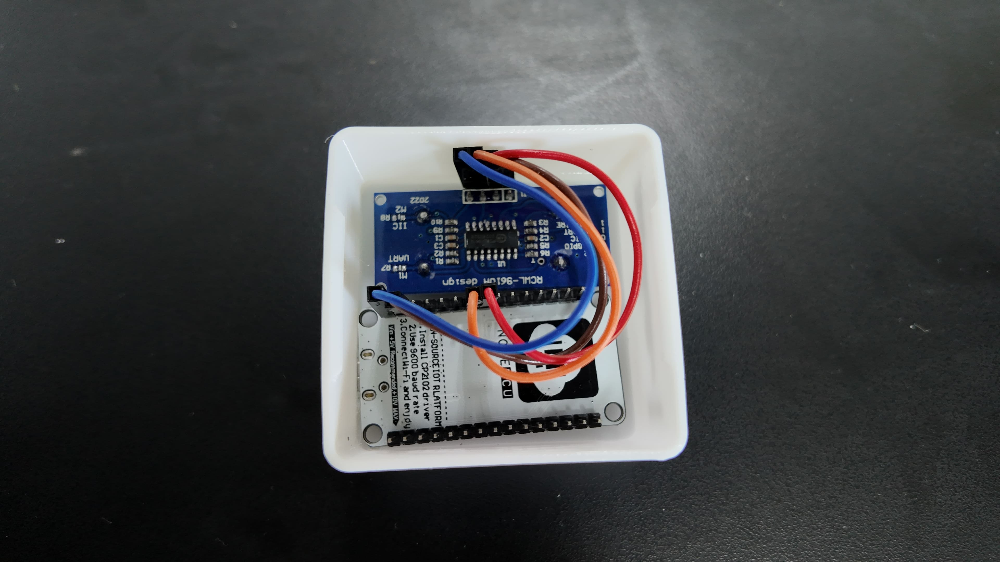
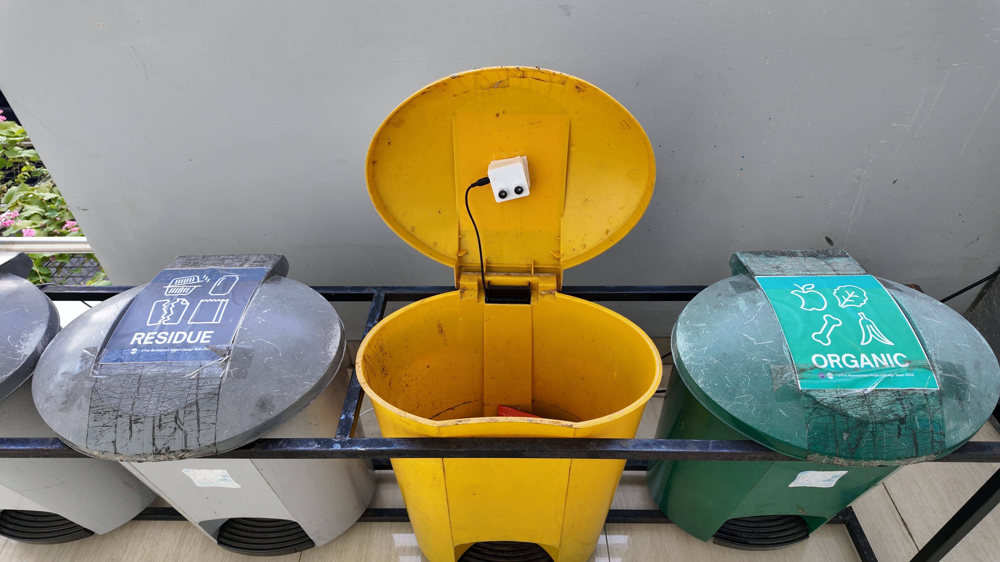

# Hawkeye ESP Sensors

## Project Overview

Hawkeye is an integrated and publicly accessible web app dashboard system that collects real-time data on the accumulation of waste from a variety of different waste bins.

 

## Technical Overview

In the development of this technology, The Hawkeye IoT device is composed of a NodeMCU ESP8266 as the microcontroller, an Ultrasonic Ranging Module HC-SR04 as the sensor, and the enclosure of the IoT device was 3D printed using a Bambu Lab A1 mini.

The sensor operates by calculating the “fullness” of a trash can by measuring the distance between the sensor and the trash accumulated in the trash can. The distance is then divided with the size of the trash can. As the distance between the sensor and the trash gets closer, the percentage of fullness gets larger.

## Operating

Each folder contains the code for each specific "hawkeye" batch / model. To create a new model/code, use the "hawkeye_withoutDeepSleep.ino" template code and replace the variables:

- **PlumeID**: the ID of your row/object in your time-series data
- **category**: this dfeines the category of the data (e.g organic, unorganic, plastic, etc.). It is passed on to be the "tag" of the data point.
- **ipUnique**: this project was piloted in a wifi network with static ip, this is for ip address
- Network setting variables (**http_username**, **http_password**): for security when uploading data to influxDB

## Improvements

Using deepSleep function in ESP8266 is heavily buggy for some reason (most likely faulty microcontroller due to prudcer), which is important if hawkeye is to be deployed using batteries only.
